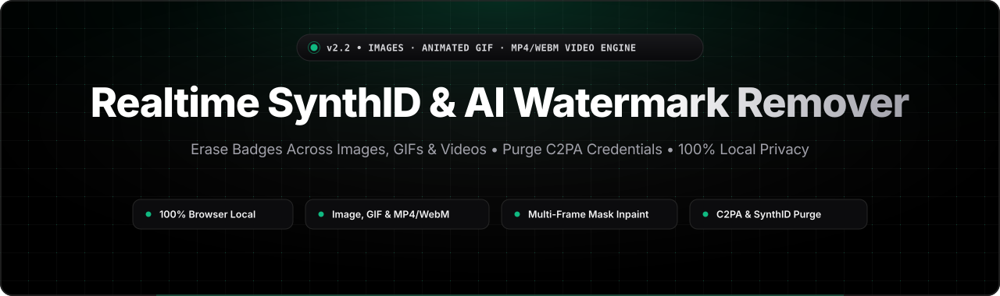
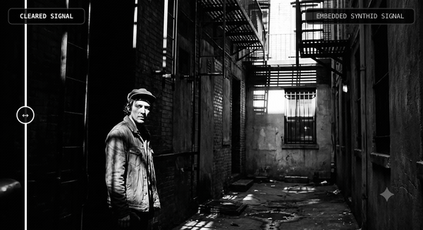
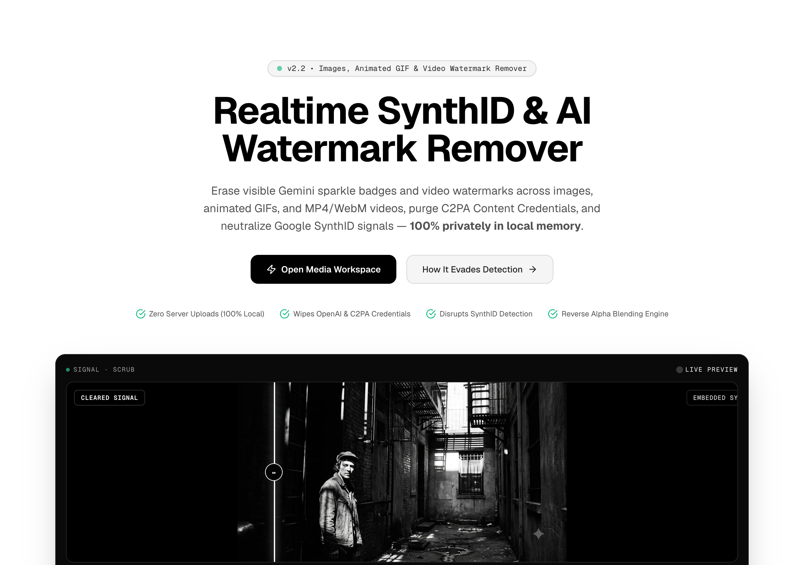
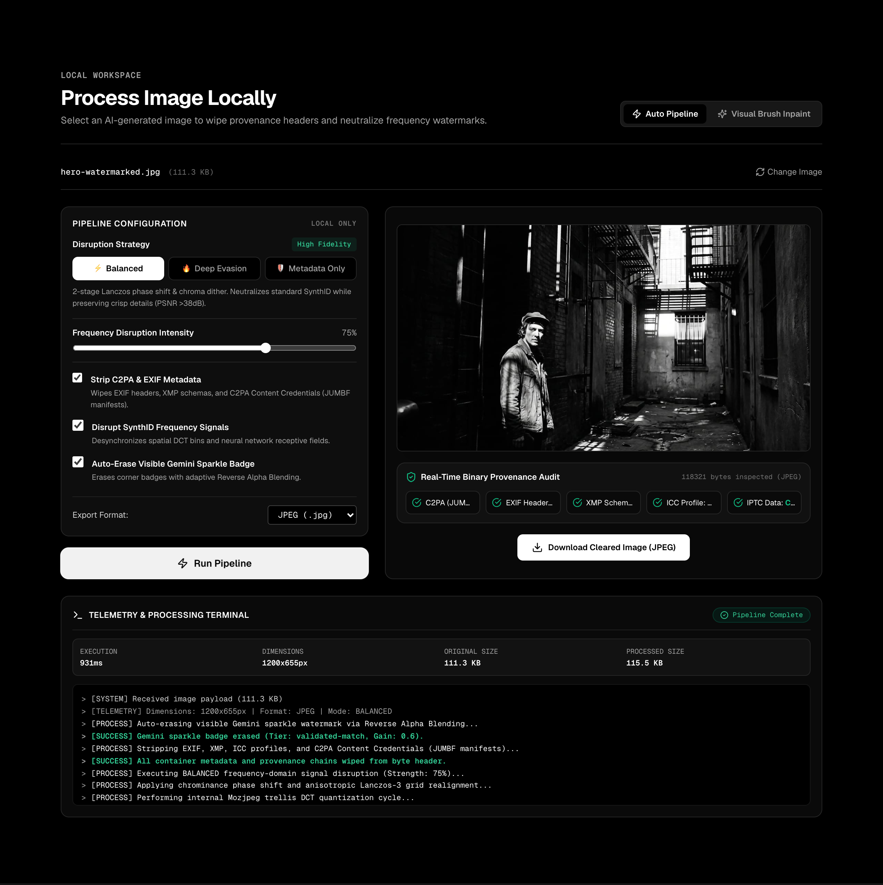
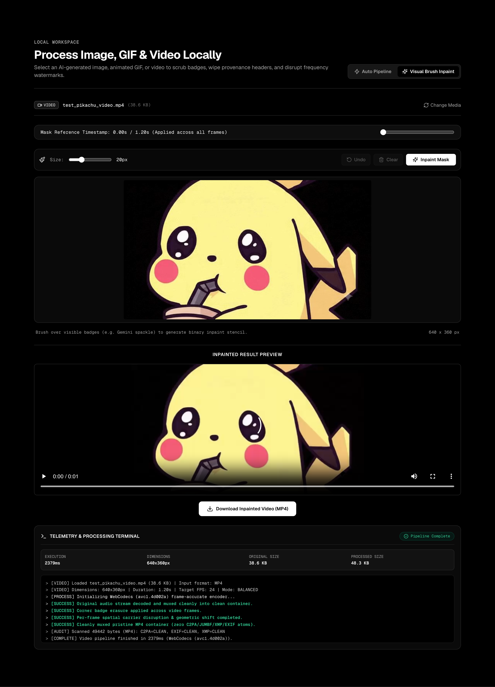
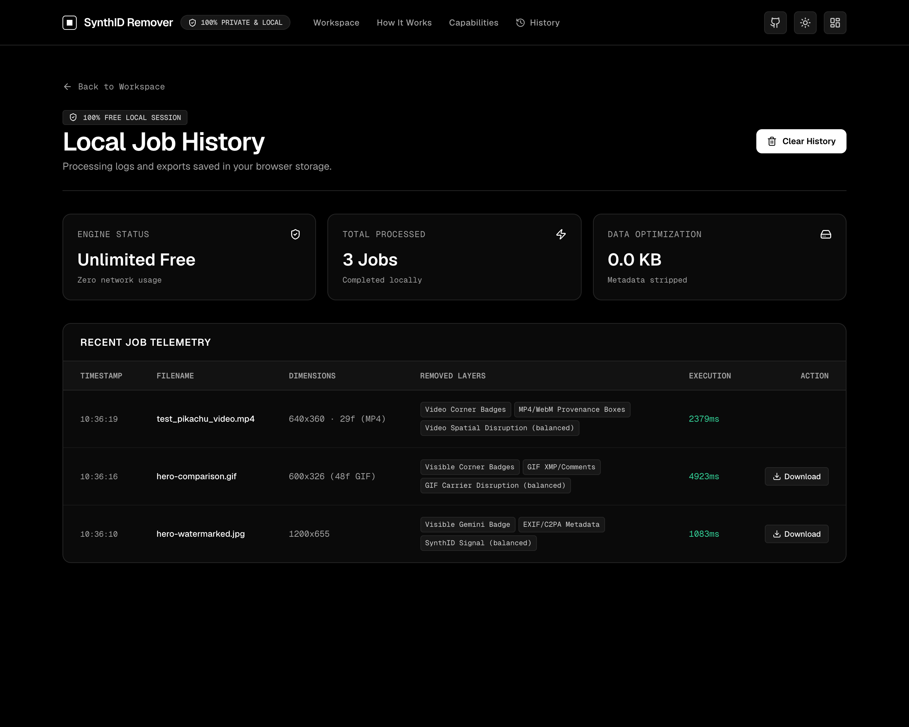

<a id="top"></a>

<div align="center">



<p><b>Scrub visible Gemini & AI watermarks, propagate brush masks across GIFs & MP4/WebM videos, purge C2PA Content Credentials, and disrupt SynthID frequency carriers — 100% locally in your browser.</b></p>

<p>
  <a href="https://jaydev-27.github.io/Synthid-remover/"></a>
  <a href="https://github.com/JayDev-27/Synthid-remover/actions/workflows/ci.yml"></a>
  <a href="https://github.com/JayDev-27/Synthid-remover/actions/workflows/deploy.yml"></a>
  <a href="https://github.com/JayDev-27/Synthid-remover/stargazers"></a>
  <a href="LICENSE"></a>
  <a href="#"></a>
</p>

<p>
  <a href="https://jaydev-27.github.io/Synthid-remover/">Live Demo</a> ·
  <a href="#-why-synthid-remover">Why SynthID Remover</a> ·
  <a href="#-supported-media--formats">Media Matrix</a> ·
  <a href="#-feature-gallery">Gallery</a> ·
  <a href="#-quick-start">Quick Start</a> ·
  <a href="#-modes--benchmarks">Benchmarks</a> ·
  <a href="#-how-it-works">Architecture</a> ·
  <a href="#-faq">FAQ</a>
</p>


<p><sub><b>Realtime Reverse Alpha Blending + SynthID Frequency Disruption</b> — clean scrub without generative redraw hallucinations.</sub></p>

</div>

---

## ✨ Why SynthID Remover

- 🔒 **Zero Uploads, 100% Private.** Everything runs inside your browser memory or local Node.js runtime — no servers, no telemetry, no queues, and no paywalls.
- 🎬 **Images, Animated GIFs & Videos.** Cleans static images (`JPG`, `PNG`, `WEBP`, `AVIF`, `HEIC`), multi-frame **GIFs** (`omggif`), and **MP4 / WebM / MOV** videos (`WebCodecs` + `mp4-muxer` / `webm-muxer`) with audio preservation.
- 🖌️ **Multi-Frame Visual Brush Inpaint.** Scrub to any GIF frame or video timestamp, paint a mask over stubborn watermarks, and reconstruct every frame across the entire clip.
- 🎯 **Adaptive Corner Erase & 16:9 Star Rescue.** Combines mathematically exact Reverse Alpha Blending (`48px`, `96px`, `outline`) with off-grid 4-point star detection for cropped or re-framed clips.
- 🛡️ **Zero-Metadata Container Re-Synthesis.** Rebuilds brand-new binary containers from raw pixels, wiping C2PA (`JUMBF`, `caBX`, `APP11`, `uuid`), EXIF, XMP, ICC, IPTC, and GIF extensions.
- ⚡ **Sub-Second Speed Without GPUs.** Replaces slow 20–60s diffusion redraws with deterministic signal disruption ($\infty$ dB PSNR in Metadata-Only mode, >38 dB on real photos in Balanced mode).

---

## 🎞️ Supported Media & Formats

| Media Type | Input Formats | Max Size | Engine & Key Capabilities | Output Formats |
| :--- | :--- | :---: | :--- | :--- |
| 🖼️ **Static Images** | `JPG`, `PNG`, `WEBP`, `AVIF`, `HEIC` | 20 MB | Reverse Alpha Blending, Star Rescue, 16–32 px Fourier phase scramble, bilateral smoothing, Mozjpeg/Sharp & Canvas 2D | `PNG`, `JPEG`, `WEBP` |
| 🎞️ **Animated GIFs** | `GIF` (`GIF87a` / `GIF89a`) | 50 MB | Pure-JS frame composition (`disposal` & timing preserved), Median Cut 256-color quantizer, multi-frame brush mask, Comment/XMP strip | `GIF` (animated) |
| 🎬 **Videos** | `MP4`, `WEBM`, `MOV`, `M4V` | 150 MB | Seek-accurate **WebCodecs** + `MediaRecorder` fallback, AAC/Opus audio passthrough, keyframe corner lock, multi-frame brush inpaint | `MP4` (`H.264/AAC`), `WEBM` (`VP9/Opus`) |

---

## 📸 Feature Gallery

<table>
<tr>
<td width="50%">
  <picture>
    <source media="(prefers-color-scheme: dark)" srcset="assets/hero.png">
    
  </picture>
  <p align="center"><sub><b>Interactive Studio (Auto Dark &amp; Light Theme)</b> — Live split-view comparison &amp; quick workspace launch</sub></p>
</td>
<td width="50%">
  
  <p align="center"><sub><b>Video Workspace &amp; Forensic Audit</b> — WebCodecs H.264/AAC export with live MP4 C2PA/EXIF/XMP verification</sub></p>
</td>
</tr>
<tr>
<td width="50%">
  
  <p align="center"><sub><b>Multi-Frame Visual Brush Inpaint</b> — Frame/timestamp scrubber + brush stencil applied across every frame</sub></p>
</td>
<td width="50%">
  
  <p align="center"><sub><b>Local Telemetry Dashboard</b> — Persistent browser-only history tracking Image, GIF, and Video jobs</sub></p>
</td>
</tr>
</table>

---

## 🚀 Quick Start

Open the live browser app immediately at **[jaydev-27.github.io/Synthid-remover](https://jaydev-27.github.io/Synthid-remover/)**, or run locally with Node.js (v18+):

```bash
git clone https://github.com/JayDev-27/Synthid-remover.git
cd Synthid-remover
npm install --legacy-peer-deps
npm run dev
```

Visit [http://localhost:3000](http://localhost:3000) in your browser.

<details>
<summary><b>More options: Automated Tests, Production Build &amp; Docker</b></summary>

```bash
# Run pipeline benchmark + 60-assertion edge-case suite (Image, GIF, MP4/WebM scanners & rescue)
npm run test:all

# Typecheck, lint & production server
npx tsc --noEmit && npm run lint && npm run build && npm start

# Docker (optional)
docker build -t synthid-remover .
docker run -p 3000:3000 synthid-remover
```

</details>

<details>
<summary><b>API &amp; TypeScript SDK Usage (cURL + Node.js)</b></summary>

**1. HTTP Endpoint (`POST /api/process`)**

```bash
curl -X POST http://localhost:3000/api/process \
  -F "file=@sample.png" \
  -F "disruptionMode=balanced" \
  -F "disruptionStrength=75" \
  -F "stripMetadata=true" \
  -F "removeVisibleBadge=true" \
  -F "format=png" \
  -o response.json
```

**2. Node.js / TypeScript Image &amp; GIF SDK**

```typescript
import fs from 'fs';
import { processImagePipeline, scanBufferProvenance } from '@/lib/imageProcessor';
import { processGifBuffer } from '@/lib/gifProcessor';

// Image pipeline
const { buffer: cleanImage } = await processImagePipeline(fs.readFileSync('input.png'), {
  disruptionMode: 'balanced', // 'balanced' | 'aggressive' | 'metadata-only'
  disruptionStrength: 75,
  stripMetadata: true,
  removeVisibleBadge: true,
  targetFormat: 'png',
});

// Animated GIF pipeline
const { bytes: cleanGif, telemetry } = await processGifBuffer(fs.readFileSync('anim.gif'), {
  disruptionMode: 'balanced',
  removeVisibleBadge: true,
  stripMetadata: true,
});

console.log('Clean container:', scanBufferProvenance(cleanImage).clean, telemetry.provenanceAudit.clean);
```

</details>

---

## ⚡ Modes & Benchmarks

| Mode | Best For | Pipeline Operations | Real Photo PSNR | Synthetic PSNR | Audit Result |
| :--- | :--- | :--- | :---: | :---: | :---: |
| ⚡ **Balanced** *(Default)* | Social media, web publishing | Bilateral carrier smooth + anisotropic shift ($98.4\% \times 97.6\%$) + Q84 DCT pass | **38.05 dB** | **42.11 dB** | **Clean (0)** |
| 🔥 **Deep Evasion** | Strict neural detectors (`synthid.com`, `openai.com/verify`) | Bounded 16–32 px Fourier octave phase scramble ($\tanh$ clamped) + 3×3 median + Q76 DCT pass | **29.24 dB** | **39.13 dB** | **Clean (0)** |
| 🛡️ **Metadata Only** | Archival & lossless pixel needs | Raw RGBA re-containerization with 100% C2PA, EXIF, XMP, ICC, IPTC purge | **$\infty$ dB** *(0.00 MSE)* | **$\infty$ dB** *(0.00 MSE)* | **Clean (0)** |

<details>
<summary><b>Full automated suite metrics (`npm run test:all` — 5 pipeline fixtures + 60 edge assertions)</b></summary>

| Metric | Metadata-Only | Balanced Mode | Deep Evasion Mode |
| :--- | :---: | :---: | :---: |
| **Container Audit (`C2PA` / `EXIF` / `XMP` / `ICC` / `GIF` / `MP4` / `WEBM`)** | **Clean (0)** | **Clean (0)** | **Clean (0)** |
| **Synthetic SVG Gradient (400×400)** | $\infty$ dB (MSE `0.00`) | `42.11 dB` (MSE `4.00`) | `39.13 dB` (MSE `7.95`) |
| **Real Textured Photograph (1200×655)** | $\infty$ dB (MSE `0.00`) | `38.05 dB` (MSE `10.18`) | `29.24 dB` (MSE `77.45`) |
| **Community Sunset Gradient (1024×682)** | $\infty$ dB (MSE `0.00`) | `32.80 dB` (MSE `34.09`) | `27.98 dB` (MSE `103.60`) |
| **60-Assertion Edge Suite (`test:edge`)** | Covers `1×1`..`2048×2048`, Format Matrix, Alpha, Corrupt Containers, GIF/MP4/WebM Audits, Off-Grid 16:9 Star Rescue (`100 → 0` luma) | — | **60 / 60 Passed** |

</details>

> [!NOTE]
> **Scientific Transparency:** Stripping container manifests (`C2PA`, `EXIF`, `XMP`, `GIF` extensions, `MP4` `uuid`/`udta`/`meta`) is mathematically deterministic and provable locally with `exiftool`, `c2patool`, or [contentauthenticity.org/inspect](https://contentauthenticity.org/inspect). Neural pixel watermarks (`Google SynthID`, `OpenAI`) are closed-source detectors — Deep Evasion applies best-effort Fourier and spatial phase desynchronization, and users should verify critical assets directly on [openai.com/verify](https://openai.com/verify) or [synthid.com/image-detection](https://synthid.com/image-detection).

<details>
<summary><b>Research notes: Why standard filters miss SynthID &amp; cropped Gemini sparkles</b></summary>

1. **Sharp Metadata Retention Fix:** Calling `.withMetadata(...)` with arguments preserves embedded C2PA/JUMBF manifests. Decoding to raw pixel arrays and synthesizing fresh containers guarantees zero surviving metadata atoms across PNG, JPEG, WebP, GIF, MP4, and WebM.
2. **16–32 px Sub-Nyquist Fourier Band:** SynthID embeds carrier energy inside $16 \le \lambda \le 32$ px Luminance ($Y$) wavelengths so watermarks survive compression and 50% downscaling. Deep Evasion scrambles phase uniformly inside $[-\pi, \pi]$ in that exact annulus while clamping spatial deltas with $\tanh$ to eliminate visible mottling or spots.
3. **Off-Grid 16:9 Sparkle Rescue:** Cropped thumbnails, GIF frames, and 16:9 video frames often shift corner sparkles off standard catalog coordinates (`32px`/`96px` margins). Our radial peak + template gradient correlation detector locates persistent 4-pointed sparkles (`tier: +star-rescue`) and removes them via inverse alpha unblending across images and keyframes.

</details>

---

## 🧠 How It Works


---

## ❓ FAQ

<details>
<summary><strong>Does my media ever get uploaded to a server?</strong></summary>

**No.** Static image, animated GIF, and video processing run locally inside browser memory (`Canvas 2D`, `TypedArray`, `omggif`, `WebCodecs` + `mp4-muxer`/`webm-muxer`). Even the static GitHub Pages build works completely client-side with zero uploads.
</details>

<details>
<summary><strong>How do GIF &amp; Video watermark removal work without FFmpeg servers?</strong></summary>

- **Animated GIFs** are decoded frame-by-frame using `omggif` (respecting frame disposal methods and centisecond timing), scrubbed across corners or your brushed mask, and quantized back into clean 256-color palettes via Median Cut with Comment/XMP extensions stripped.
- **Videos (`MP4` / `WEBM` / `MOV`)** extract frames deterministically, lock onto corner badges or apply your `Visual Brush Inpaint` mask across every frame, decode &amp; re-mux clean AAC/Opus audio, and export fresh provenance-free containers via browser `WebCodecs` (or `MediaRecorder` fallback).
</details>

<details>
<summary><strong>How do I remove non-Gemini watermarks like Sora, Runway, or custom text logos?</strong></summary>

Upload your image, GIF, or video, switch to the **Visual Brush Inpaint** tab, scrub to a clear reference frame/timestamp, brush over the watermark, and click **Inpaint Mask**. The engine propagates boundary-diffusion reconstruction across every frame.
</details>

<details>
<summary><strong>Does transparent PNG / GIF alpha survive cleaning?</strong></summary>

**Yes.** Both the image and animated GIF pipelines detect alpha channels automatically and preserve transparency (via alpha-safe PNG/WebP encoding for images and transparent palette index reservation for GIFs).
</details>

---

## 🗺️ Roadmap

- [x] Client-side local Canvas 2D & TypedArray processing pipeline
- [x] Automated C2PA (`JUMBF` / `caBX` / `APP11` / `uuid`), EXIF, XMP & IPTC container stripper
- [x] Bounded Luminance Fourier phase scrambler ($16 \le \lambda \le 32$ px)
- [x] Adaptive Gemini visible watermark eraser (48px, 96px, outline, & off-grid 16:9 rescue)
- [x] Animated GIF multi-frame disposal, scrubbing & Visual Brush Inpaint propagation
- [x] Client-side MP4 / WebM / MOV video watermark removal via WebCodecs & clean container muxing
- [x] Automated pipeline + 60-assertion edge-case regression suites (`npm run test:all`)
- [ ] WebAssembly SIMD-accelerated FFT for instant 4K browser processing
- [ ] Standalone CLI utility for batch folder media cleaning

---

## 🛠️ Tech Stack & Contributing

<p>
  <a href="https://skillicons.dev">
    
  </a>
</p>

Contributions, bug reports, and research findings are welcome:

1. Fork the repository and create a branch (`git checkout -b feature/your-feature`)
2. Run verification (`npm run test:all && npm run lint && npm run build`)
3. Open a Pull Request targeting `main`

---

## 📄 License

Distributed under the **MIT License**. See [LICENSE](LICENSE) for full details.

---

<div align="center">
  <sub>If SynthID Remover helped protect your privacy, consider giving it a ⭐ · <a href="#top">Back to top ↑</a></sub>
</div>
